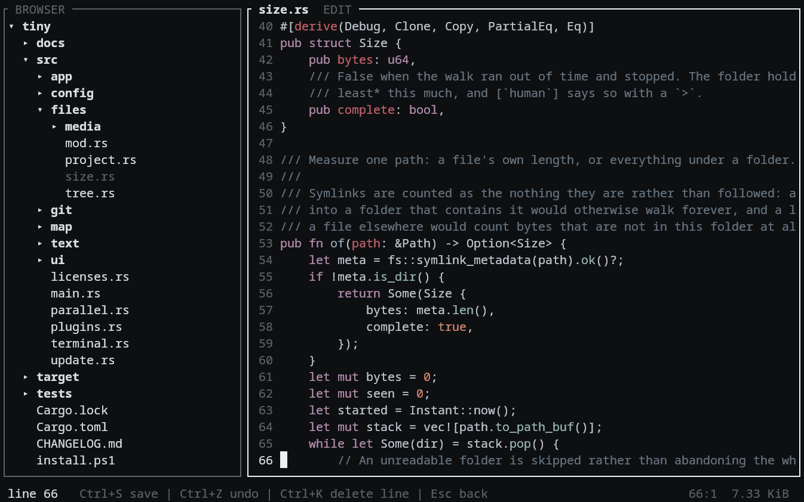
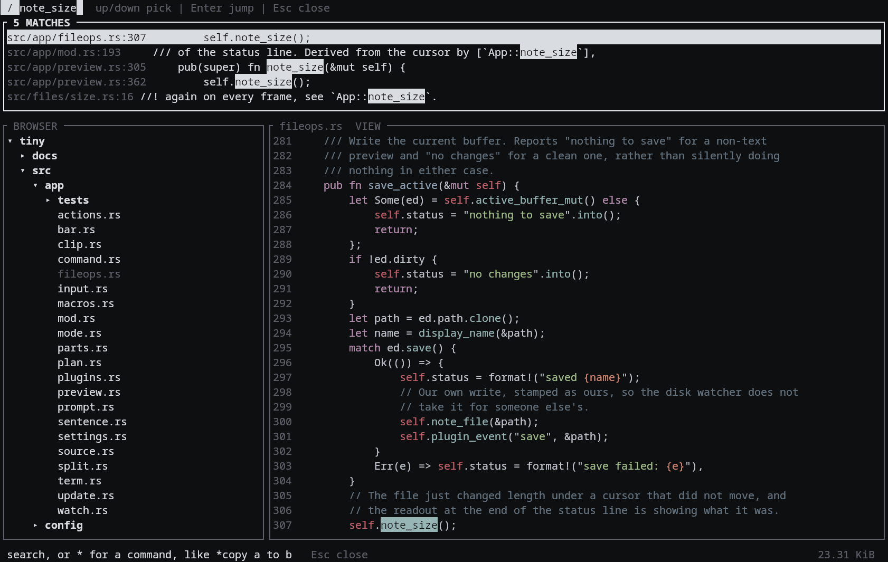
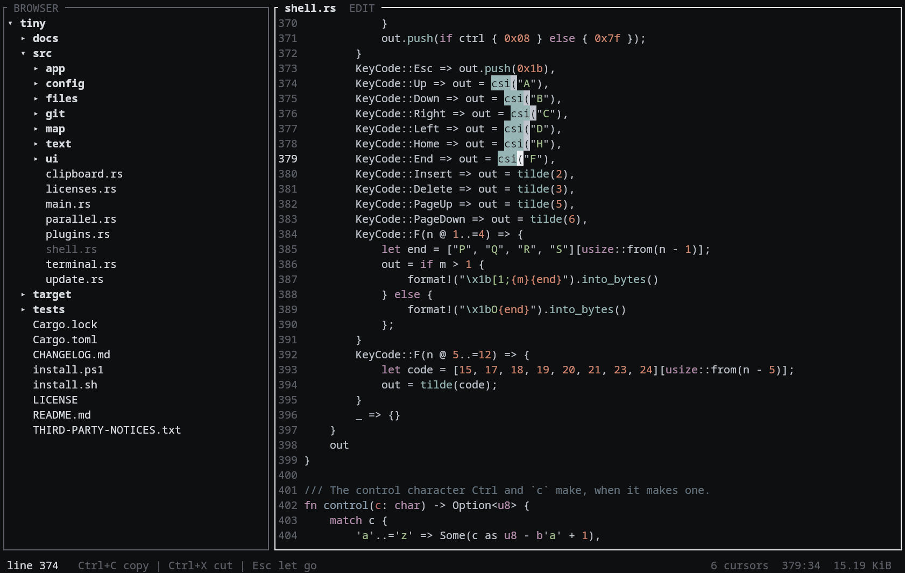
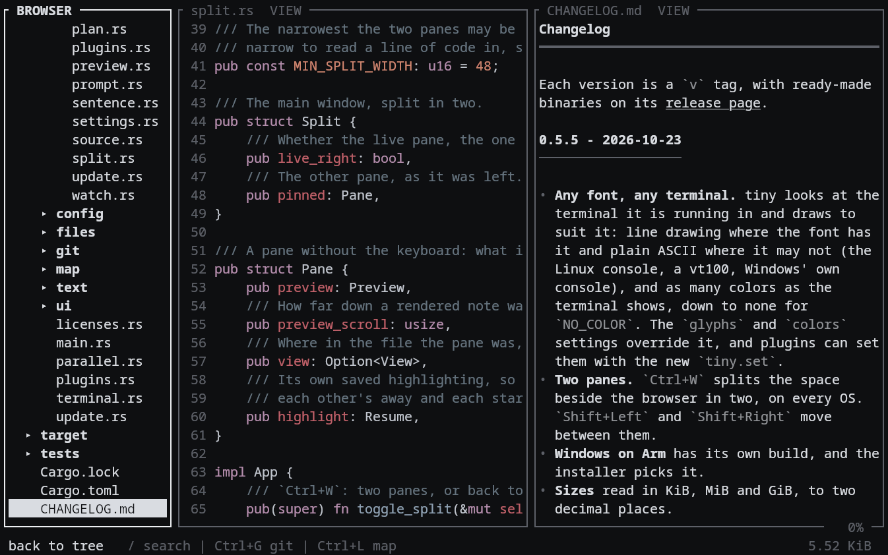
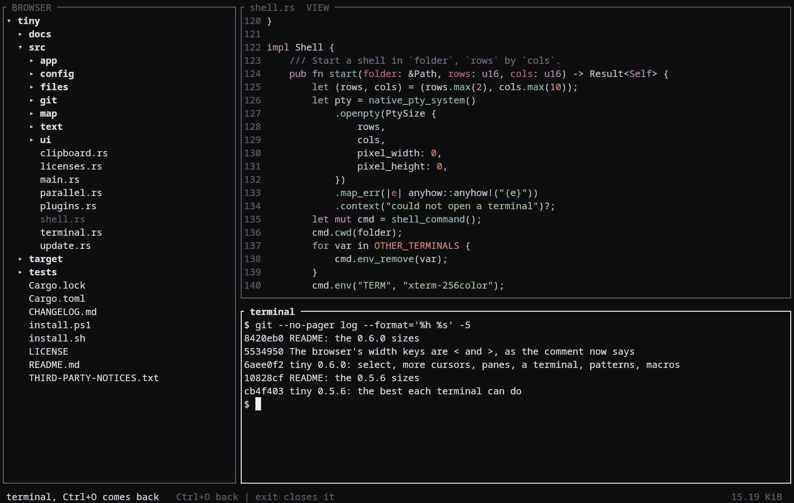
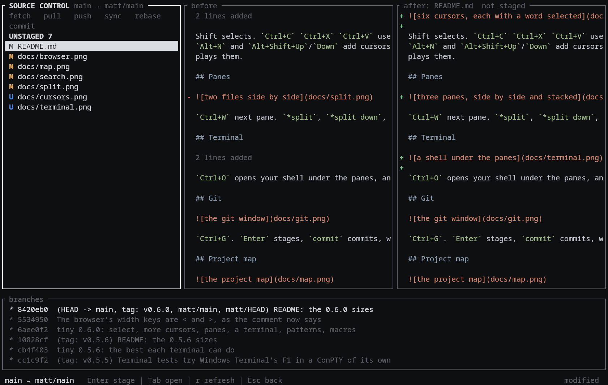
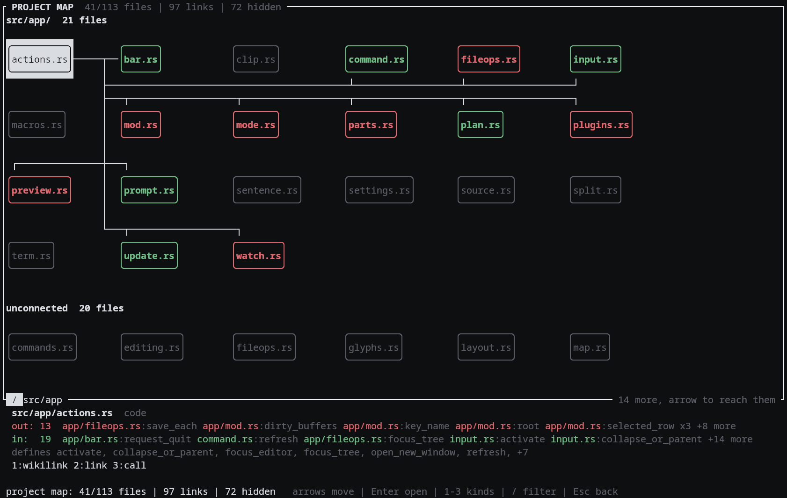
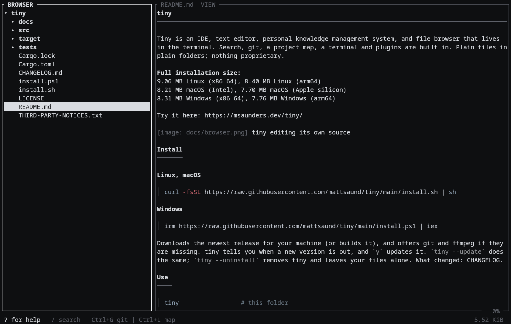

# tiny

Tiny is an IDE, text editor, personal knowledge management system, and file
browser that lives in the terminal. Search, git, a project map, a terminal and
plugins are built in. Plain files in plain folders; nothing proprietary.

**Full installation size:**\
9.06 MB Linux (x86_64), 8.40 MB Linux (arm64)\
8.21 MB macOS (Intel), 7.70 MB macOS (Apple silicon)\
8.31 MB Windows (x86_64), 7.76 MB Windows (arm64)

Try it here: https://msaunders.dev/tiny/



## Install

**Linux, macOS**

```sh
curl -fsSL https://raw.githubusercontent.com/mattsaund/tiny/main/install.sh | sh
```

**Windows**

```powershell
irm https://raw.githubusercontent.com/mattsaund/tiny/main/install.ps1 | iex
```

Downloads the newest [release](https://github.com/mattsaund/tiny/releases) for
your machine (or builds it), and offers git and ffmpeg if they are missing.
tiny tells you when a new version is out, and `y` updates it. `tiny --update` does
the same; `tiny --uninstall` removes tiny and leaves your files alone.
What changed: [CHANGELOG](CHANGELOG.md).

## Use

```sh
tiny                 # this folder
tiny ~/notes         # that folder, made if it is missing
tiny ~/code/main.py  # that file
```

## Search everything



`/` searches names and contents as you type. `/fn \w+/` is a regex. `*` starts
a command.

## Editing



Shift selects. `Ctrl+C` `Ctrl+X` `Ctrl+V` use your system's clipboard.
`Alt+N` and `Alt+Shift+Up`/`Down` add cursors. `Ctrl+R` records keys, `Ctrl+P`
plays them.

## Panes



`Ctrl+W` next pane. `*split`, `*split down`, `*close`.

## Terminal



`Ctrl+O` opens your shell under the panes, and comes back.

## Git



`Ctrl+G`. `Enter` stages, `commit` commits, with the git you already have.

## Project map



`Ctrl+L`. Wikilinks, markdown links and calls between files: green reaches
this file, red is what it reaches.

## Notes, pictures, PDFs



Markdown renders as you read it; `Enter` edits. Headings at every level,
tables, fenced code with syntax colors, quotes and task lists. Pictures, video,
audio and PDFs open in your own viewer.

## Keys

`?` shows every key, and so does `man tiny`.

| key | does |
|---|---|
| arrows, `i` `j` `k` `l` | move |
| `Enter`, `Esc` | open, back |
| `Ctrl+S` | save (on a folder, all of it) |
| `/`, `Ctrl+F` | search |
| `Shift` and a move, `Ctrl+A` | select, select all |
| `Ctrl+C`, `Ctrl+X`, `Ctrl+V` | copy, cut, paste |
| `Alt+N`, `Alt+Shift+Up`/`Down` | more cursors |
| `Ctrl+R`, `Ctrl+P` | record keys, play them |
| `Ctrl+G`, `Ctrl+L` | git, map |
| `Ctrl+W`, `Ctrl+O` | next pane, terminal |
| `Ctrl+T`, `<` `>` | hide the browser, its width |
| `Ctrl+N` | another tiny window |
| `Ctrl+Q` | quit |

## Commands

Say it in words. The line under the bar says what Enter will do.

```
*goto line 42                 *copy temp.txt to notes
*goto function main           *move temp.txt to notes
*goto word todo in a.md       *rename old.md to new.md
*goto file notes.md           *new notes/today.md
*replace hi with hello        *delete old.md
*replace hi with hey in a.md  *set tab_width to 2
*replace /(\w+)@a/ with $1@b  *split down
*play 20                      *close
```

Names are found anywhere in the project. No `in` means everywhere. `go to`,
`open`, `cp`, `rm`, `*42` and the rest work too.

## Plugins

A plugin is a Lua file in the plugins folder, which `Plugins` in settings
opens. Drop one in and `*reload`.

```lua
-- words.lua: *words counts them
tiny.command("words", function()
  local n = 0
  for _ in tiny.text():gmatch("%S+") do n = n + 1 end
  tiny.status(n .. " words")
end)
```

`tiny.command` `tiny.on("open"/"save")` `tiny.status` `tiny.text`
`tiny.set_text` `tiny.insert` `tiny.cursor` `tiny.go` `tiny.path` `tiny.root`
`tiny.open` `tiny.set`

## Config

`*config` opens the settings; `tiny --config` prints where `tiny.conf` is.
tiny uses your terminal's font and colors, and picks its characters and
colors to suit the terminal it is in. `glyphs` (`unicode`, `console`,
`ascii`) and `colors` (`truecolor`, `256`, `16`, `none`) override that.
`cursor_shape` (`block`, `bar`, `underline`) and `cursor_blink` set the
cursor. Keys go in `[keys]`:

```toml
glyphs = "ascii"

[keys]
down        = "z"
editor.undo = "ctrl+u"
```

## Contributing

**AI policy.** I am open to AI and agentic coding, but the code written needs
to follow specific guidelines:

1. MUST be human readable, acceptable variable/function names.
2. Easily traceable, following a good program flow.
3. Contributors MUST look at and document code and code changes. You need to
   understand the code that is being written.

**Tests.** `cargo test`, `cargo clippy` and `cargo fmt`. CI runs all three on
Linux, macOS and Windows, and starts tiny in a terminal there: under eleven
terminal names, at several sizes, and inside tmux and GNU screen. A version
is released by tagging it; see `.github/workflows/release.yml`.

## License and credits

Created by Matthew Saunders, https://msaunders.dev

MIT. See [LICENSE](LICENSE). Everything compiled in (every crate, Lua, the
color themes) is permissive, with its copyright and license in
[THIRD-PARTY-NOTICES.txt](THIRD-PARTY-NOTICES.txt); `tiny --licenses` prints
it, with the syntax definitions from [bat](https://github.com/sharkdp/bat) via
[two-face](https://codeberg.org/CosmicHarper/two-face).
